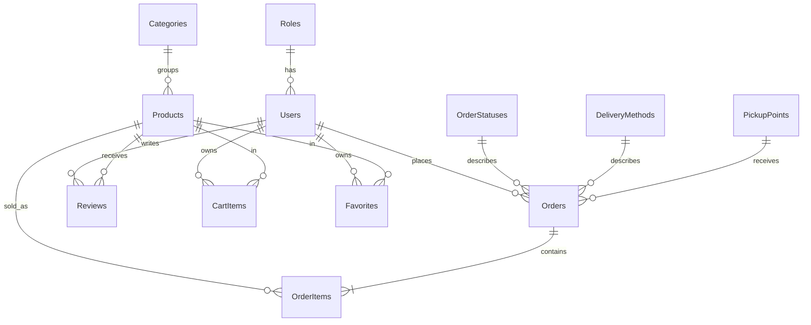

# База данных

Схема приведена к третьей нормальной форме.

- Каждый атрибут атомарен: пароль хранится одним полем-хешем, адрес доставки одной строкой.
- Справочники вынесены в отдельные таблицы: роли, статусы заказов, способы получения, категории, пункты выдачи.
- Нет транзитивных зависимостей. Итог заказа и средняя оценка товара не хранятся, а вычисляются из
  позиций заказа и отзывов, поэтому не могут разойтись с исходными данными.
- Цена в позиции заказа хранится отдельно от цены товара. Это не дубль, а факт покупки: старые заказы
  не меняются при изменении цены.

| Таблица | Ключ | Назначение |
|---|---|---|
| Roles | Id | Admin, User |
| Users | Id, уникальный Login | учетные записи, хеш пароля, роль |
| Categories | Id, уникальный Name | категории товаров |
| Products | Id | товар: цена, описание, файл изображения, остаток, штук в упаковке, доступность |
| Reviews | Id, уникальная пара ProductId + UserId | оценка и отзыв, один на пользователя |
| CartItems | UserId + ProductId | корзина |
| Favorites | UserId + ProductId | избранное |
| PickupPoints | Id | пункты выдачи |
| OrderStatuses | Id | справочник статусов |
| DeliveryMethods | Id | доставка или самовывоз |
| Orders | Id | заказ: дата, пользователь, статус, способ, адрес или пункт выдачи |
| OrderItems | Id | позиции заказа: количество и цена на момент покупки |

Ограничения целостности заданы на уровне базы: цена и остаток не отрицательные, оценка от 1 до 5,
количество в корзине и в заказе положительное.
